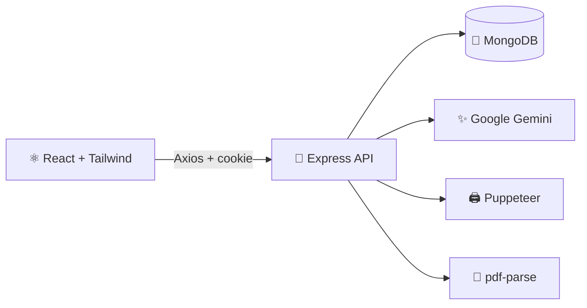
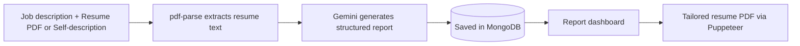

<div align="center">

# 🚀 GenAI JobPrep

### AI-powered Interview Preparation Platform

Paste a job description, add your resume or a short self-description, and get a **personalized interview report**, a **day-by-day prep roadmap** and a **job-tailored resume PDF**.

<p>
  
  
  
  
  
  
  
</p>

<p>
  <a href="https://genai-job-prep-chi.vercel.app"></a>
  <a href="https://genai-job-prep-backend.onrender.com"></a>
</p>

</div>

---

## 📑 Table of Contents

- [🌐 Live Demo](#-live-demo)
- [✨ Features](#-features)
- [🏗️ How It Works](#️-how-it-works)
- [🛠️ Tech Stack](#️-tech-stack)
- [📂 Project Structure](#-project-structure)
- [✅ Prerequisites](#-prerequisites)
- [🔑 Configuration](#-configuration)
- [▶️ Run Locally](#️-run-locally)
- [📖 How to Use](#-how-to-use)
- [📡 API Reference](#-api-reference)
- [📜 Available Scripts](#-available-scripts)
- [🚀 Deployment](#-deployment)
- [🔐 Security Notes](#-security-notes)

---

## 🌐 Live Demo

The project is deployed and ready to try:

| | Link |
|---|---|
| 🖥️ **Frontend (App)** — Vercel | [genai-job-prep-chi.vercel.app](https://genai-job-prep-chi.vercel.app) |
| ⚙️ **Backend (API)** — Render | [genai-job-prep-backend.onrender.com](https://genai-job-prep-backend.onrender.com) |

> 💡 Create a free account on the live app, paste a job description, and generate your first interview report in under a minute.
>
> ⏳ If the backend has been idle, the first request may take a few seconds while the Render service wakes up.

---

## ✨ Features

| | Feature |
|---|---|
| 🔑 | Register and log in with an account |
| 🧠 | Generate an interview report from a job description and candidate profile |
| 📄 | Upload a PDF resume (up to **3 MB**) **or** enter a self-description instead |
| 📊 | AI-generated profile-to-role **match score** |
| 💻 | Technical and behavioral interview questions with the **interviewer's intent** and **suggested answers** |
| 🧩 | Skill gaps tagged with **low / medium / high** severity |
| 📅 | Day-by-day **preparation plan** |
| 📥 | Download a **tailored resume as PDF** |
| 🕘 | Revisit recent interview plans from the dashboard |

---

## 🏗️ How It Works





---

## 🛠️ Tech Stack

| Area | Technologies |
| --- | --- |
| 🎨 **Frontend** | React, Vite, React Router, Tailwind CSS, Axios |
| ⚙️ **Backend** | Node.js, Express |
| 🗄️ **Database** | MongoDB with Mongoose |
| 🤖 **AI** | Google Gemini through the Google GenAI SDK |
| 📄 **PDF processing** | `pdf-parse` for uploaded resumes; Puppeteer for generated resume PDFs |
| 🔐 **Authentication** | JSON Web Tokens, HTTP-only cookies, bcrypt password hashing |

---

## 📂 Project Structure

```text
.
├── backend/
│   ├── server.js
│   └── src/
│       ├── config/          # Database connection
│       ├── controllers/     # Authentication and interview handlers
│       ├── middlewares/     # Authentication and PDF upload handling
│       ├── models/          # User and interview report models
│       ├── routes/          # API routes
│       └── services/        # Gemini and PDF generation
└── frontend/
    └── src/
        ├── features/auth/       # Registration, login, and auth state
        └── features/interview/  # Dashboard, reports, and interview state
```

---

## ✅ Prerequisites

- 🟢 Node.js and npm
- 🍃 A MongoDB database (local or hosted)
- 🔮 A Google Gemini API key

Install dependencies independently for the backend and frontend:

```bash
cd backend
npm install

cd ../frontend
npm install
```

---

## 🔑 Configuration

Create `backend/.env`:

```dotenv
MONGO_URI=mongodb://127.0.0.1:27017/genai-job-prep
JWT_SECRET=replace-with-a-long-random-secret
GOOGLE_GENAI_API_KEY=your-google-gemini-api-key
FRONTEND_URL=http://localhost:5173
```

> `MONGO_URI`, `JWT_SECRET` and `GOOGLE_GENAI_API_KEY` are **required** to connect to MongoDB, sign authentication tokens and generate AI content. `FRONTEND_URL` is used to configure the frontend origin for deployment; local development also allows `http://localhost:5173`.

For local frontend development, create `frontend/.env`:

```dotenv
VITE_API_URL=http://localhost:3000
```

> The frontend has a hosted backend URL as its default API base. Setting `VITE_API_URL` makes a local frontend send requests to your local backend.

🚫 Do not commit `.env` files or real API keys. The repository's `.gitignore` excludes environment files.

---

## ▶️ Run Locally

Open two terminals from the project root.

**Terminal 1 — backend**

```bash
cd backend
npm run dev
```

The Express server listens on **http://localhost:3000**.

**Terminal 2 — frontend**

```bash
cd frontend
npm run dev
```

Vite prints the local frontend URL when it starts (typically **http://localhost:5173**). Open it, create an account and generate an interview plan from the dashboard.

---

## 📖 How to Use

1. 🔑 Register or log in.
2. 📝 From the dashboard, paste a target **job description**.
3. 👤 Add a candidate profile by uploading a **PDF resume** or entering a **self-description**.
4. ⚡ Generate the interview strategy.
5. 📊 Review the match score, skill gaps, technical and behavioral questions and the preparation roadmap.
6. 📥 Click **Download Resume** to generate a tailored resume PDF.

---

## 📡 API Reference

The backend API is served from `http://localhost:3000`. Protected endpoints accept the authentication token in the HTTP-only `token` cookie or an `Authorization: Bearer <token>` header.

| Method | Endpoint | Access | Description |
| :---: | --- | :---: | --- |
| `POST` | `/api/auth/register` | 🌐 Public | Create an account with `username`, `email` and `password`. |
| `POST` | `/api/auth/login` | 🌐 Public | Log in with `email` and `password`. |
| `GET` | `/api/auth/logout` | 🌐 Public | Clear the login cookie and invalidate its token. |
| `GET` | `/api/auth/get-me` | 🔒 Authenticated | Get the current user's details. |
| `POST` | `/api/interview/` | 🔒 Authenticated | Generate a report. Submit `jobDescription`, and either `selfDescription` or a PDF file in the multipart `resume` field. |
| `GET` | `/api/interview/` | 🔒 Authenticated | List the current user's recent reports. |
| `GET` | `/api/interview/report/:interviewId` | 🔒 Authenticated | Get a report by ID. |
| `POST` | `/api/interview/resume/pdf/:interviewReportId` | 🔒 Authenticated | Generate and download a report-specific resume PDF. |

📌 The resume upload is limited to **3 MB**. The report-generation endpoint requires a job description and at least one of a resume or self-description.

---

## 📜 Available Scripts

Run these commands from their respective package directories.

**Backend (`backend/`)**

| Command | Description |
| --- | --- |
| `npm run dev` | Start the backend with Nodemon. |
| `npm test` | Placeholder script; no backend test suite is configured yet. |

**Frontend (`frontend/`)**

| Command | Description |
| --- | --- |
| `npm run dev` | Start the Vite development server. |
| `npm run build` | Create a production build in `frontend/dist/`. |
| `npm run preview` | Preview the production build locally. |
| `npm run lint` | Run ESLint. |

---

## 🚀 Deployment

The app is deployed as two separate services: the **frontend** (Vite build) on **Vercel** and the **backend** (Express API) on **Render**, with a hosted MongoDB database.

**Backend environment variables (on your hosting platform):**

```dotenv
MONGO_URI=your-hosted-mongodb-connection-string
JWT_SECRET=your-long-random-secret
GOOGLE_GENAI_API_KEY=your-google-gemini-api-key
FRONTEND_URL=https://genai-job-prep-chi.vercel.app
```

**Frontend environment variable (set before building):**

```dotenv
VITE_API_URL=https://genai-job-prep-backend.onrender.com
```

**Deployment checklist**

- [ ] Set `FRONTEND_URL` to the exact deployed frontend origin so CORS with credentials works
- [ ] Point `VITE_API_URL` to the deployed backend, then rebuild the frontend (`npm run build`)
- [ ] Allow your backend's IP in the MongoDB network access list instead of `0.0.0.0/0` where possible
- [ ] Use secure cookie settings (`secure`, `sameSite`) when frontend and backend are on different domains over HTTPS
- [ ] Make sure the hosting environment can run Puppeteer (headless Chrome) for the resume PDF feature

---

## 🔐 Security Notes

- 🔒 Passwords are hashed with **bcrypt**; they are never stored as plain text.
- 🍪 Auth tokens live in **HTTP-only cookies**, so browser JavaScript cannot read them.
- 🚪 Logout clears the cookie **and invalidates the token**, so a copied token stops working.
- 🙈 Keep API keys and secrets in `.env` files only, and use a long random `JWT_SECRET`.

---

<div align="center">

⭐ **If you found this project helpful, please give it a star!** ⭐

Made with ❤️ using React, Node.js, MongoDB and Gemini AI

</div>
